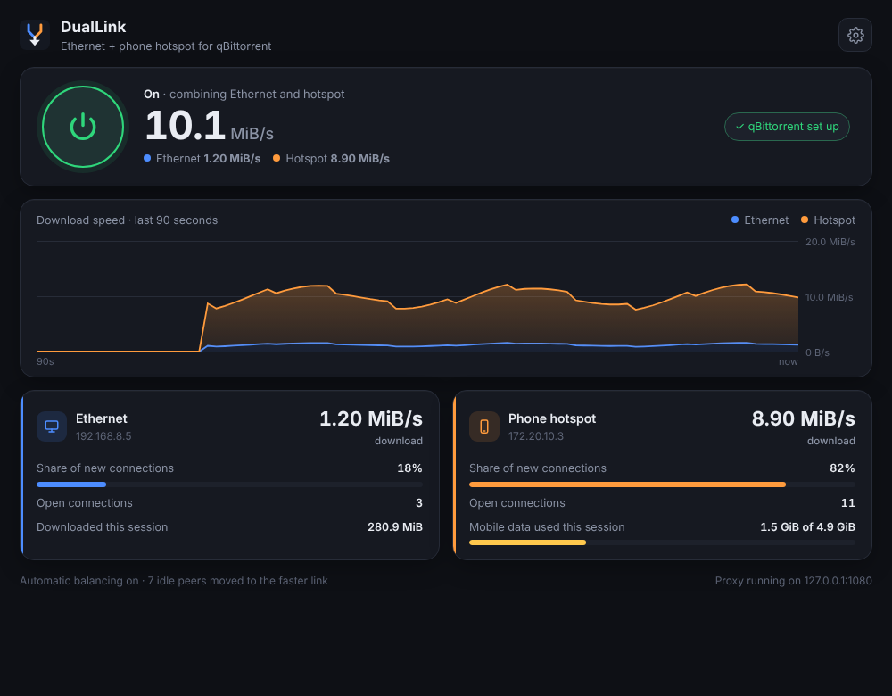

<p align="center"></p>

<h1 align="center">DualLink</h1>
<p align="center">Download one torrent over your <b>Ethernet</b> and your <b>phone hotspot</b> at the same time.</p>

<p align="center"></p>

## How it works

A torrent downloads from many peers at once. DualLink runs a small proxy on your PC.
qBittorrent sends its peer connections through it, and DualLink sends each one out over
either Ethernet or the hotspot. A single torrent therefore uses both internet connections.

- **Picks the faster connection automatically.** DualLink measures the download speed per connection
  on each link every few seconds and sends more new peers to the faster one. The slower link always keeps
  at least 15%, so it is still measured. A link that hasn't carried data yet counts as "unknown", not "slow".
- **Moves idle peers.** Peers that have been idle for 90 s on the slower link are reconnected and
  land on the faster one.
- **Sets up qBittorrent for you.** When DualLink is turned on, it points qBittorrent at the proxy
  and reconnects running downloads. When it is turned off, your original qBittorrent settings are restored.
- **Mobile data limit.** Optionally stop using the hotspot after a set amount of data. The rest
  continues over Ethernet.
- Runs in the system tray, shows live speed graphs, and can start with Windows.

## Install

1. Download `DualLink.exe` from the [Releases](../../releases) page. No installation or Python needed.
2. **One-time qBittorrent setup:** in qBittorrent open **Tools › Options › Web UI**, tick
   **Web User Interface (Remote control)** (port 8080), tick
   **Bypass authentication for clients on localhost**, and click OK.
   (If you'd rather not use the Web UI, DualLink can show the manual proxy settings instead.)
3. Connect Ethernet and your phone hotspot (USB tethering or Wi-Fi), start DualLink, and press the power button.

> Windows may show a SmartScreen warning because the .exe isn't code-signed. Click
> **More info › Run anyway**, or build it yourself from source (below).

## Good to know

- **Mobile data:** if your hotspot is the faster link, most of the download goes over it. On a capped plan,
  set a limit in Settings (off by default).
- **TCP peers:** peer downloads use TCP so they can be balanced across both links. uTP is turned off while
  DualLink is on.
  Other peers also can't connect in to you (outgoing connections work as normal).
- **DHT and UDP trackers work through DualLink.** This small, low-bandwidth traffic is kept on
  Ethernet (or the hotspot if Ethernet is unavailable), so qBittorrent finds as many peers as without DualLink.
  The footer shows "DHT connected" once qBittorrent is using it.
- More peers means a better split: DualLink raises qBittorrent's connection limits to at least 500 / 200 per torrent.

## Troubleshooting

| Problem | Fix |
|---|---|
| "qBittorrent: not reachable" | Turn on qBittorrent's Web UI (Install, step 2), then press **Try again**. |
| "qBittorrent: login needed" | Enter the Web UI username/password in Settings, or tick *Bypass authentication for clients on localhost*. |
| Hotspot shows connections but stays at 0 B/s | In an admin PowerShell run `netsh interface ipv4 set interface "<hotspot adapter name>" weakhostsend=enabled`, then turn DualLink off and on. |
| "qBittorrent: not reachable" even though the Web UI is ticked | qBittorrent's **IP address** field must be just `127.0.0.1` (or `*`), not a full `http://...` address. |
| "Could not listen on port 1080" | Another program uses that port. Pick a different proxy port in Settings. |
| Hotspot not in the list | Connect the phone first, then press **refresh the list** in Settings. |

## Build from source

Requires Windows 10/11 and Python 3.10+.

```bat
git clone https://github.com/<you>/DualLink.git
cd DualLink
python -m pip install -r requirements.txt
python main.py            :: run from source
build.bat                 :: run tests and build dist\DualLink.exe
```

Every push to GitHub runs the tests on Windows and builds `DualLink.exe`. You can find it under
**Actions › latest run › Artifacts**. To publish a release, push a tag:

```bash
git tag v1.0.0
git push origin v1.0.0
```

## Project layout

```
main.py                    entry point
duallink/engine.py         SOCKS5 proxy + automatic balancing (no dependencies)
duallink/qbt.py            qBittorrent Web UI setup/restore
duallink/controller.py     settings, on/off, statistics, start-with-Windows
duallink/app.py            window (pywebview) + system tray (pystray)
duallink/ui/index.html     the interface
tests/                     pytest suite (runs on Windows in CI)
```

Settings are stored in `%APPDATA%\DualLink\config.json`. That includes the qBittorrent Web UI password,
if you enter one, in plain text. Nothing leaves your PC: the proxy only listens on 127.0.0.1.

## License

MIT
